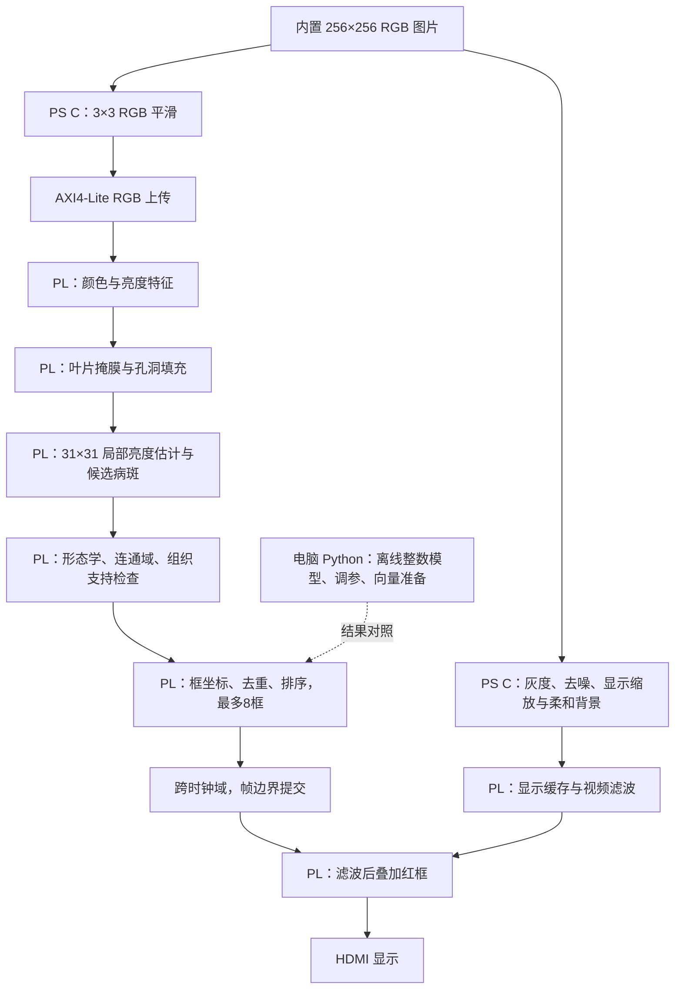

# v2.0：PS 预处理、PL 病斑检测与 HDMI 输出

此文保留首次迁移记录。当前默认使用 [v2.1 加速版](29_pl_detector_acceleration_v2_1.md)，原约4秒耗时已优化，第15张完整图片处理实测约358ms。

## 当前分工



当前没有摄像头或网络依赖，输入仍为原24张图片，顺序及标签不变。PS 传给检测模块的是彩色 RGB，不是显示分支生成的灰度图。

`ps_app/pl_detector.c` 负责 RGB 平滑、上传、启动、等待和读取结果。`src/rtl/pl_pest_detector.v` 完成实际检测、框坐标计算和排序，直接接入原 PL 红框及 HDMI 通路。PS 读取坐标只是用于串口核验，不回写检测框坐标。

新固件启用 `PEST_USE_PL`，通过链接器回收未调用的旧 C 检测函数；v2.0 ELF 中已确认不存在 `pest_detect` 符号。原 `ps_app/pest.c` 仍保存离线基线及显示预处理函数，发生 PL 错误时不会回退到 CPU 检测，也不会报告为健康。

## 硬件实现

- 每个像素在 PL 内生成5位亮度、颜色候选、叶片种子、组织与绿色支持标志，存入9位特征帧 RAM。
- 第二块9位帧 RAM 复用为局部亮度估计、叶片掩膜、病斑工作掩膜及形态学中间状态。
- 叶片种子做闭运算，四连通外部洪泛填充孔洞，再收缩边缘。硬件初版保留全部种子区域，与旧 C 版取最大连通域的方式不同。
- 通过31×31灰度闭运算和局部对比提取候选，开、闭运算处理细桥和裂隙，再做八连通病斑分析。
- 检查面积、形状、周边组织支持和灰褐色病斑证据；按量化局部对比总和排名，并抑制重复框。
- 使用2048项洪泛前沿队列。超出容量会报错并停止输出该次检测结果，PS明确打印错误。
- 检测使用5位量化亮度以控制存储资源。因此这是同类算法的硬件实现，不声称与v1.7的8位C算法逐位等价；Python模型对应当前硬件规则。
- 初版没有迁移v1.7的接受后边缘扩展步骤。不能因分类结果一致就声称每处病斑覆盖相同。
- 框由 PL 生成后，经 CDC 暂存到帧边界提交；切换图片时先隐藏旧框，新图片上传并检测完成后再显示新框。

## 接口与控制

复用原 AXI4-Lite 图像写入寄存器，不修改 Block Design 端口。

| 项目 | 说明 |
|---|---|
| 图像缓冲地址0..78719 | 原320×240主图及32×60背景 |
| 虚拟地址80000..80003 | 每像素一个32位字：低字节依次R、G、B，最高字节保留 |
| 虚拟地址80004..80007 | 控制字：`{opcode, reserved, selector, brown_cut}` |
| opcode 1 / 2 / 3 / 4 | 开始上传 / 开始计算 / 清除 / 选择读回项目 |
| STATUS，AXI偏移0x14 | 默认高字节D2，低位busy/done/error/active，[11:8]框数 |
| selector 1 / 2 | PL时钟周期数 / 已接收像素数 |
| selector 16..31 | 8个框的显示坐标端点 |
| selector 40..47 | 8个框的核心连通域面积 |

上传必须完整包含65536个像素，缺失帧不允许运行。主图、柔和背景及现有滤波控制方式继续保留。串口`n/b/p/o/s`等命令继续使用，菜单标明v2.0、PL Verilog检测。

## Python 的用途

Python运行在电脑上，负责可复核的硬件整数模型、阈值实验和仿真输入。检测函数不读取样本标签，标签仅用于最后计算分类结果。

```powershell
python tools/pl_detector_model.py
python tools/prepare_pl_vectors.py
python tools/check_pl_board.py
```

调参示例：

```powershell
python tools/pl_detector_model.py --brown-cut 7 --output build/pl_detector/threshold7.json
```

硬件默认brown-cut=6，对应串口棕色门限15减9。修改离线模型参数不会自动修改板卡。`--radius`改变离线窗口；硬件窗口改变需修改RTL参数并重新生成bitstream。

## 构建与复测

推荐使用新入口，不使用旧的换ROM演示脚本作为v2.0部署入口。

```powershell
# 完整仿真、硬件构建、ARM编译、上板及结果对照
./tools/rebuild_pl_detector.ps1 -Sample 15

# 只改PS控制程序，复用已经验证的v2.0硬件
./tools/rebuild_pl_detector.ps1 -SkipHardware -Sample 15

# 分别运行
./tools/build_pest_app.ps1 -Version 2_0
./tools/verify_pest_board.ps1 -Version 2_0 -Sample 15
python tools/check_pl_board.py
```

硬件构建脚本将原工程克隆到新的英文路径，不覆盖旧bitstream。v1.7回退仍可显式选择`-Version 1_7`，配套使用旧v1.5显示bitstream。

## 验证与资源

RTL仿真使用独立合成输入，逐像素比较叶片和候选掩膜，并比较框数、坐标、面积及顺序；覆盖重复换帧、不完整输入和前沿队列溢出。帧边界CDC另有仿真。真实PS C预处理与Python对所有24张图片的每个像素一致。

通过时序的项目为 `D:/fpga_build/pl_detector_1792825303`，bitstream为 `D:/fpga_build/bits/system_top_v2_0.bit`。最终WNS +0.257ns、WHS +0.039ns，setup/hold均无失败端点；LUT 6363/17600、FF 4040/35200，BRAM 59.5/60。BRAM已接近上限，后续新增缓存必须重新核算。

初版为资源受限的顺序扫描检测器，不能声称比CPU版本更快，也不能把HDMI刷新率当作病斑检测帧率。完整检测耗时需以板卡周期数及PS计时为准。24张样本参与过算法调试，分类成绩不能作为独立测试集准确率，也不能替代病斑位置标注和框级漏检评价。


## 实际上板结果

v2.0 bitstream与ELF已通过JTAG下载，COM7全24张复测完成。TP=11、TN=12、FP=0、FN=1，23/24；15、19均有硬件病斑框，24仍输出未检出可靠病斑。所有24张的框数、坐标、核心面积和顺序与Python完全一致，硬件错误计数0。

最大PS预处理、上传及PL检测时间3987186us（约3.987s，不包含显示渲染与主图上传）；15的PL计数393907244周期，在100MHz下约3.939s。旧PS C检测约0.182s，计时范围不同，但本硬件初版明显更慢。改为PL的职责目标已实现，不能作为加速成果。后续提速需设计并行/行缓存窗口并重新核算已接近满载的BRAM及LUT资源。

板卡当前停在15，框1个，串口已释放。未独立拍摄HDMI，实际屏幕效果还需观察。日志`build/pest_review/board_uart_v2_0.txt`，硬件读回`build/pl_detector/board_results.json`，构建与源码哈希`build/pl_detector/manifest.json`。
